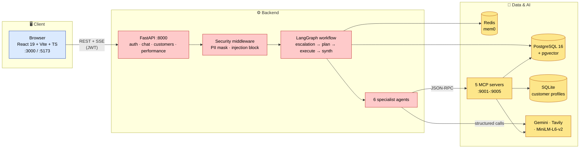
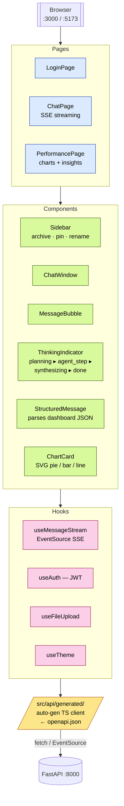
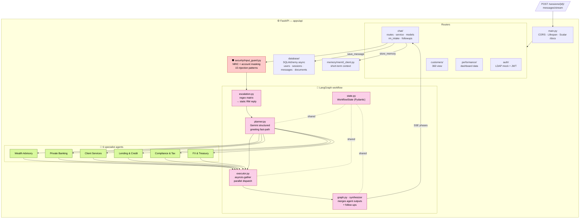
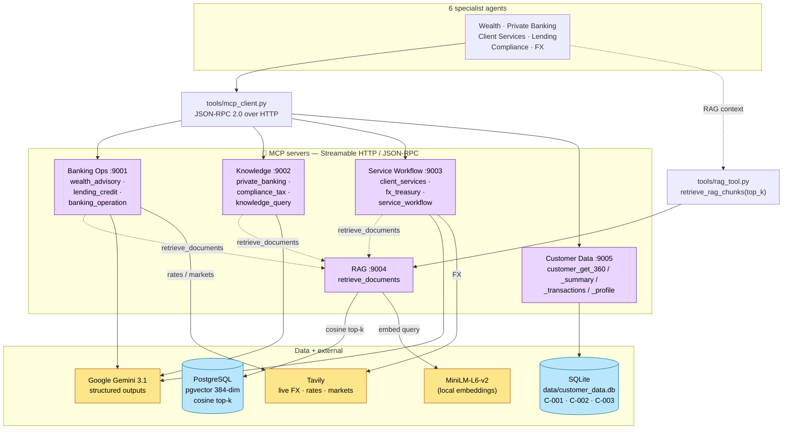
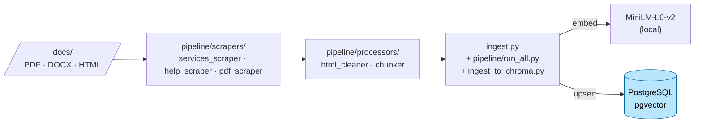
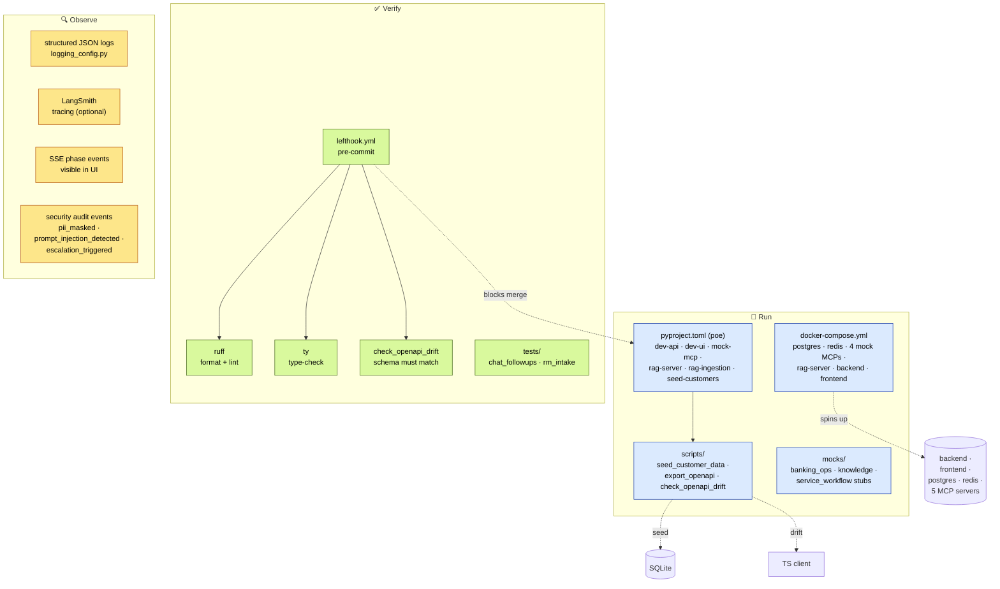

# UBS Wealth Management Chatbot — System Design

The architecture is presented as five focused diagrams instead of one mega-diagram. Each can be read and explained on its own.

1. [System overview](#1-system-overview) — the three tiers end-to-end
2. [Frontend architecture](#2-frontend-architecture) — React app: pages, components, hooks, generated client
3. [Backend + workflow](#3-backend--workflow) — FastAPI routers, security middleware, LangGraph plan-and-execute, 6 agents
4. [RAG + MCP](#4-rag--mcp) — where grounded answers come from
5. [Infrastructure / DevOps](#5-infrastructure--devops) — containers, checks, observability

---

## 1. System overview

The 30-second view: three tiers, each only talking to its neighbours. Client → Backend → Data/AI.

**Request lifecycle**

1. Browser sends a question over REST + SSE with a JWT.
2. FastAPI runs the security middleware (PII mask, injection check).
3. The LangGraph workflow plans the work, runs specialist agents in parallel, and synthesises one reply.
4. Each agent calls its MCP server for tool-use, and may pull grounded context from RAG and live data from Tavily.
5. The reply streams back as SSE; the user message and assistant reply are persisted in Postgres, with conversation context saved to Redis (mem0).

---

## 2. Frontend architecture

React app. Pages render components, components use hooks, hooks talk to a TypeScript client that is auto-generated from the backend's OpenAPI schema.

**Key idea — no drift.** The backend exports `openapi.json` on every change; `scripts/check_openapi_drift.py` enforces in CI that the committed schema matches the live app. The TypeScript client in `src/api/generated/` is regenerated from that schema, so the frontend cannot drift from the API contract.

**SSE phases the UI renders.** As the workflow runs, the `ThinkingIndicator` shows `planning ▸ agent_step ▸ synthesizing ▸ done` based on events streamed from the backend.

---

## 3. Backend + workflow

FastAPI receives the request and runs the LangGraph plan-and-execute pipeline.

**Specialist-agent → MCP routing**

| Agent | MCP backend |
|---|---|
| Wealth Advisory | Banking Ops :9001 |
| Lending & Credit | Banking Ops :9001 |
| Private Banking | Knowledge :9002 |
| Compliance & Tax | Knowledge :9002 |
| Client Services | Service Workflow :9003 |
| FX & Treasury | Service Workflow :9003 |
| *(all)* | RAG :9004 (grounding) · Customer Data :9005 (context) |

**Why this shape works.** The escalation node is a hard regex gate — anything advisory or distress-flagged bypasses the LLM entirely. The planner returns a Pydantic-validated `Plan` object (no free-form parsing). The executor uses `asyncio.gather`, so a slow agent does not block the others. The synthesizer is the only place the final response is composed.

---

## 4. RAG + MCP

Where grounded answers come from. Agents do not trust the LLM's memory — they call MCP servers, which look things up in real data.

### MCP tool inventory

| MCP server | Port | Exposed tools |
|---|---|---|
| Banking Ops | 9001 | `wealth_advisory`, `lending_credit`, `banking_operation` |
| Knowledge | 9002 | `private_banking`, `compliance_tax`, `knowledge_query` |
| Service Workflow | 9003 | `client_services`, `fx_treasury`, `service_workflow` |
| RAG | 9004 | `retrieve_documents` |
| Customer Data | 9005 | `customer_get_360`, `customer_get_summary`, `customer_get_transactions`, `customer_get_profile` |

### RAG ingestion (offline)

Documents become searchable chunks before they can ground an answer.

**Customer data is MCP-fronted by default.** API routes call `customer_get_360` on `:9005`; the same SQLite bundle backs the dashboard and the workflow, so the chatbot and the Performance page never disagree. `CUSTOMER_DATA_ACCESS_MODE=direct` lets the API fall back to reading SQLite directly for local troubleshooting.

---

## 5. Infrastructure / DevOps

### Environments

| Mode | Command | What you get |
|---|---|---|
| Full stack | `docker compose up` | Postgres + Redis + 5 MCP servers + RAG + backend + frontend |
| Hot-reload dev | `poe dev-api` + `poe dev-ui` + `poe mock-mcp` + `poe rag-server` | Same surface, individual processes |
| Data reset | `poe seed-customers` | Rebuild SQLite from approved profiles |
| RAG reset | `poe rag-ingestion` | Re-embed and re-upsert documents to pgvector |

### Quality gates

- **Lefthook pre-commit** — runs `ruff format`, `ruff lint`, `ty` type-check, and OpenAPI drift check before any commit lands.
- **OpenAPI as the contract** — backend exports `openapi.json`; the TypeScript client is regenerated from it; CI fails if the committed schema diverges from the live app.
- **Pydantic everywhere** — every LLM call returns a typed object; schema-validation failures fail closed, never silently.
- **Tests** — `pytest` covers the chat follow-up flow and the RM-intake escalation flow.

### Observability

- **Structured logs** — every service emits JSON with consistent keys.
- **LangSmith traces** — optional, on planner / executor / synthesizer for post-incident replay.
- **UI thinking indicator** — `planning ▸ agent_step ▸ synthesizing ▸ done` visible to the user, drawn from real workflow events.
- **Security events** — `pii_masked`, `prompt_injection_detected`, `escalation_triggered` are all audit-tagged.
