# UBS Wealth Management Chatbot — System Design

```mermaid
graph TB
    %% =========================================================
    %% CLIENT TIER
    %% =========================================================
    subgraph CLIENT["🖥️ Client Tier — React 19 + Vite + TypeScript (apps/ui)"]
        direction TB
        BROWSER[["Browser<br/>localhost:3000 / :5173"]]
        subgraph PAGES["Pages"]
            LOGIN[LoginPage.tsx]
            CHAT_PAGE[ChatPage.tsx<br/>SSE streaming]
            PERF_PAGE[PerformancePage.tsx<br/>charts + insights]
        end
        subgraph COMPS["Components"]
            SIDEBAR[Sidebar<br/>archive / pin / rename]
            CHAT_WIN[ChatWindow]
            MSG_BUBBLE[MessageBubble]
            THINK[ThinkingIndicator<br/>planning ▸ agent_step ▸<br/>synthesizing ▸ done]
            STRUCT[StructuredMessage<br/>JSON dashboard parser]
            CHART[ChartCard<br/>SVG pie/bar/line]
        end
        subgraph HOOKS["Hooks"]
            U_STREAM[useMessageStream<br/>EventSource SSE]
            U_AUTH[useAuth — JWT]
            U_FILE[useFileUpload]
            U_LLM[useLlmMode]
            U_THEME[useTheme]
        end
        APIGEN[/"src/api/generated/<br/>auto-gen TS client<br/>← openapi.json"/]
        BROWSER --> PAGES --> COMPS --> HOOKS --> APIGEN
    end

    %% =========================================================
    %% API GATEWAY / FASTAPI
    %% =========================================================
    subgraph API["⚙️ FastAPI Backend — apps/api (port 8000)"]
        direction TB
        MAIN["main.py<br/>CORS · Lifespan · Scalar /docs"]
        subgraph SEC["🛡️ Security"]
            INPUT_GUARD["input_guard.py<br/>PII mask (NRIC, Acct)<br/>Prompt-injection regex"]
        end
        subgraph ROUTES["Routers"]
            R_AUTH["auth/<br/>LDAP mock + JWT"]
            R_CHAT["chat/<br/>routes · service · models<br/>rm_intake · followups · file_parser"]
            R_CUST["customers/<br/>routes · data_service · registry<br/>sqlite_repository · customer_data_client"]
            R_PERF["performance/routes.py"]
        end
        MEM["memory/mem0_client.py<br/>(short-term, lazy singleton)"]
        DB_LAYER["database/<br/>SQLAlchemy async<br/>User · ChatSession · ChatMessage · Document"]
        MAIN --> SEC --> ROUTES
        ROUTES --> DB_LAYER
        ROUTES --> MEM
    end

    %% =========================================================
    %% LANGGRAPH WORKFLOW
    %% =========================================================
    subgraph WF["🧠 LangGraph Plan-and-Execute Workflow — apps/api/workflow"]
        direction TB
        ESC["escalation.py<br/>distress / advisory bypass<br/>→ static RM response"]
        PLAN["planner.py<br/>Gemini structured output<br/>greeting fast-path"]
        EXEC["executor.py<br/>asyncio.gather dispatch"]
        SYN["graph.py · synthesizer<br/>merges agent outputs<br/>+ follow-ups"]
        STATE["state.py<br/>WorkflowState (Pydantic)"]
        ESC --> PLAN --> EXEC --> SYN
        STATE -.shared.- PLAN
        STATE -.shared.- EXEC
        STATE -.shared.- SYN
    end

    %% =========================================================
    %% SPECIALIST AGENTS
    %% =========================================================
    subgraph AGENTS["👥 6 Specialist Agents — workflow/agents"]
        direction LR
        A_WEALTH["Wealth Advisory<br/>portfolio · risk (VaR, Sharpe)<br/>perf attribution · Tavily"]
        A_PRIV["Private Banking<br/>accounts · transfers<br/>cross-border · prefs"]
        A_CS["Client Services<br/>onboarding · KYC/AML<br/>appointments"]
        A_LEND["Lending & Credit<br/>Lombard · LTV · covenants<br/>live rates (Tavily)"]
        A_COMP["Compliance & Tax<br/>CRS/FATCA · KYC refresh<br/>tax-loss harvesting"]
        A_FX["FX & Treasury<br/>live FX (Tavily)<br/>hedging · derivatives"]
    end

    %% Agent shared tools
    MCP_CLIENT["tools/mcp_client.py<br/>JSON-RPC 2.0 HTTP"]
    RAG_TOOL["tools/rag_tool.py<br/>retrieve_rag_chunks(top_k)"]

    %% =========================================================
    %% MCP SERVERS (Streamable HTTP)
    %% =========================================================
    subgraph MCP["🔌 MCP Servers — Streamable HTTP / JSON-RPC"]
        direction TB
        MCP_BANK["Banking Ops :9001<br/>tools: wealth_advisory ·<br/>lending_credit · banking_operation"]
        MCP_KNOW["Knowledge :9002<br/>tools: private_banking ·<br/>compliance_tax · knowledge_query"]
        MCP_SVC["Service Workflow :9003<br/>tools: client_services ·<br/>fx_treasury · service_workflow"]
        MCP_RAG["RAG MCP :9004<br/>tool: retrieve_documents<br/>(rag/server.py)"]
        MCP_CUST["Customer Data :9005<br/>tools: customer_get_360 ·<br/>_summary · _transactions · _profile"]
    end

    %% =========================================================
    %% RAG PIPELINE
    %% =========================================================
    subgraph RAGP["📚 RAG Pipeline — rag/"]
        direction TB
        SCRAPERS["pipeline/scrapers/<br/>services_scraper · help_scraper<br/>pdf_scraper"]
        PROC["pipeline/processors/<br/>html_cleaner · chunker"]
        INGEST["ingest.py<br/>+ pipeline/run_all.py<br/>+ ingest_to_chroma.py"]
        DOCS_SRC[/"docs/<br/>PDFs / DOCX / HTML"/]
        DOCS_SRC --> SCRAPERS --> PROC --> INGEST
    end

    %% =========================================================
    %% DATA TIER
    %% =========================================================
    subgraph DATA["💾 Storage"]
        direction TB
        PG[("PostgreSQL 16<br/>:5432<br/>users · chat_sessions · chat_messages<br/>documents (pgvector 384-dim, cosine)")]
        REDIS[("Redis Stack<br/>:6379<br/>mem0 short-term memory")]
        SQLITE[("SQLite<br/>data/customer_data.db<br/>C-001 · C-002 · C-003<br/>approved demo profiles")]
    end

    %% =========================================================
    %% EXTERNAL AI / OBSERVABILITY
    %% =========================================================
    subgraph EXT["🌐 External Services"]
        direction TB
        GEMINI["Google Gemini 3.1<br/>structured outputs (Pydantic)<br/>planner · agents · synthesizer"]
        TAVILY["Tavily Search API<br/>live FX · rates · markets<br/>(depth=5)"]
        LANGSMITH["LangSmith<br/>tracing (optional)"]
        HF["sentence-transformers/<br/>all-MiniLM-L6-v2<br/>(local, in models/)"]
    end

    %% =========================================================
    %% MOCKS / DEV / OPS
    %% =========================================================
    subgraph OPS["🐳 Dev & Ops"]
        direction TB
        DOCKER["docker-compose.yml<br/>postgres · redis · 4 mock MCPs ·<br/>rag-server · backend · frontend"]
        SCRIPTS["scripts/<br/>seed_customer_data · export_openapi<br/>check_openapi_drift"]
        POE["pyproject.toml (poe)<br/>dev-api · dev-ui · mock-mcp<br/>rag-server · rag-ingestion · check"]
        MOCKS["mocks/<br/>banking_ops · knowledge<br/>service_workflow (stubs)"]
        TESTS["tests/<br/>test_chat_followups<br/>test_rm_intake"]
        HOOKS_GIT["lefthook.yml<br/>ruff · ty · openapi-drift"]
    end

    %% =========================================================
    %% CONNECTIONS — Request flow
    %% =========================================================
    BROWSER -- "REST + SSE<br/>JWT bearer" --> MAIN
    APIGEN -- fetch / EventSource --> MAIN

    R_AUTH --> DB_LAYER
    R_CHAT --> SEC
    R_CHAT -- "POST /sessions/{id}/<br/>messages/stream" --> ESC
    R_CUST --> MCP_CUST
    R_CUST -. "fallback (direct mode)" .-> SQLITE
    R_PERF --> R_CUST

    PLAN --> A_WEALTH & A_PRIV & A_CS & A_LEND & A_COMP & A_FX
    A_WEALTH & A_PRIV & A_CS & A_LEND & A_COMP & A_FX --> EXEC
    EXEC --> SYN

    A_WEALTH & A_LEND -- via --> MCP_CLIENT
    A_PRIV & A_COMP --- MCP_CLIENT
    A_CS & A_FX --- MCP_CLIENT

    MCP_CLIENT --> MCP_BANK
    MCP_CLIENT --> MCP_KNOW
    MCP_CLIENT --> MCP_SVC
    MCP_CLIENT --> MCP_CUST
    A_WEALTH & A_PRIV & A_CS & A_LEND & A_COMP & A_FX -. RAG context .-> RAG_TOOL --> MCP_RAG

    %% MCP servers cross-call RAG for grounding
    MCP_BANK -. retrieve_documents .-> MCP_RAG
    MCP_KNOW -. retrieve_documents .-> MCP_RAG
    MCP_SVC  -. retrieve_documents .-> MCP_RAG

    %% MCP servers use external APIs
    MCP_BANK -- LLM / live data --> GEMINI
    MCP_KNOW --> GEMINI
    MCP_SVC  --> GEMINI
    MCP_BANK -- rates / markets --> TAVILY
    MCP_SVC  -- FX --> TAVILY

    %% RAG storage
    INGEST -- "embed + upsert" --> PG
    MCP_RAG -- "cosine top-k" --> PG
    MCP_RAG -- embed query --> HF
    INGEST -- embed --> HF
    MCP_CUST --> SQLITE

    %% Backend ↔ data
    DB_LAYER --> PG
    MEM --> REDIS
    MEM -- embed --> HF

    %% Workflow ↔ LLM ↔ tracing
    PLAN -- structured output --> GEMINI
    SYN  -- structured output --> GEMINI
    EXEC -. trace .-> LANGSMITH
    PLAN -. trace .-> LANGSMITH
    SYN  -. trace .-> LANGSMITH

    %% SSE response back to UI
    SYN -- "yield: planning ▸ agent_step ▸<br/>synthesizing ▸ done" --> R_CHAT
    R_CHAT -. "rm_intake / followups<br/>post-process" .-> SYN
    R_CHAT -- "SSE event-stream" --> U_STREAM

    %% Persistence on done
    R_CHAT -- save_message --> DB_LAYER
    R_CHAT -- store_memory --> MEM

    %% Ops links
    DOCKER -.spins up.-> PG
    DOCKER -.spins up.-> REDIS
    DOCKER -.spins up.-> MCP_BANK
    DOCKER -.spins up.-> MCP_KNOW
    DOCKER -.spins up.-> MCP_SVC
    DOCKER -.spins up.-> MCP_CUST
    DOCKER -.spins up.-> MCP_RAG
    DOCKER -.spins up.-> MAIN
    DOCKER -.spins up.-> BROWSER
    SCRIPTS -. seed .-> SQLITE
    SCRIPTS -. drift check .-> APIGEN
    POE --> SCRIPTS
    HOOKS_GIT -. pre-commit .-> POE

    %% =========================================================
    %% STYLING
    %% =========================================================
    classDef ext fill:#fde68a,stroke:#b45309,color:#000
    classDef store fill:#bae6fd,stroke:#0369a1,color:#000
    classDef sec fill:#fecaca,stroke:#b91c1c,color:#000
    classDef agent fill:#d9f99d,stroke:#3f6212,color:#000
    classDef mcp fill:#e9d5ff,stroke:#6b21a8,color:#000
    classDef wf fill:#fbcfe8,stroke:#9d174d,color:#000
    class GEMINI,TAVILY,LANGSMITH,HF ext
    class PG,REDIS,SQLITE store
    class INPUT_GUARD,SEC sec
    class A_WEALTH,A_PRIV,A_CS,A_LEND,A_COMP,A_FX agent
    class MCP_BANK,MCP_KNOW,MCP_SVC,MCP_RAG,MCP_CUST mcp
    class ESC,PLAN,EXEC,SYN,STATE wf
```

## How to read it — request lifecycle

1. **Browser → FastAPI** ([apps/api/main.py](../apps/api/main.py)) over REST (JWT) and SSE.
2. **Security middleware** ([input_guard.py](../apps/api/security/input_guard.py)) masks PII (NRIC, account #s) and blocks prompt-injection patterns.
3. **Chat route** ([chat/routes.py](../apps/api/chat/routes.py)) checks `rm_intake`, then enters the LangGraph stream.
4. **Escalation** → **Planner (Gemini)** → **Executor** (parallel `asyncio.gather` over selected agents) → **Synthesizer**.
5. Each agent calls its **MCP server** via JSON-RPC ([mcp_client.py](../apps/api/workflow/tools/mcp_client.py)); MCP servers may pull **RAG** from `:9004` and **live market data** from Tavily.
6. **RAG MCP** ([rag/server.py](../rag/server.py)) does cosine top-k against PostgreSQL `documents` (pgvector, 384-dim, MiniLM-L6-v2 embeddings).
7. **Customer data** flows via MCP `:9005` → SQLite `data/customer_data.db` (C-001/002/003 demo profiles); same bundle powers the dashboard ([performance/routes.py](../apps/api/performance/routes.py)).
8. SSE phases (`planning ▸ agent_step ▸ synthesizing ▸ done`) stream back to [useMessageStream.ts](../apps/ui/src/hooks/useMessageStream.ts); final message is persisted in Postgres and short-term memory is written to Redis (mem0).

## MCP tool inventory

| MCP server | Port | Exposed tools |
|---|---|---|
| Banking Ops | 9001 | `wealth_advisory`, `lending_credit`, `banking_operation` |
| Knowledge | 9002 | `private_banking`, `compliance_tax`, `knowledge_query` |
| Service Workflow | 9003 | `client_services`, `fx_treasury`, `service_workflow` |
| RAG | 9004 | `retrieve_documents` |
| Customer Data | 9005 | `customer_get_360`, `customer_get_summary`, `customer_get_transactions`, `customer_get_profile` |

## Specialist-agent → MCP routing

| Agent | MCP backend |
|---|---|
| Wealth Advisory | Banking Ops :9001 |
| Lending & Credit | Banking Ops :9001 |
| Private Banking | Knowledge :9002 |
| Compliance & Tax | Knowledge :9002 |
| Client Services | Service Workflow :9003 |
| FX & Treasury | Service Workflow :9003 |
| *(all)* | RAG :9004 (grounding), Customer Data :9005 (context) |
